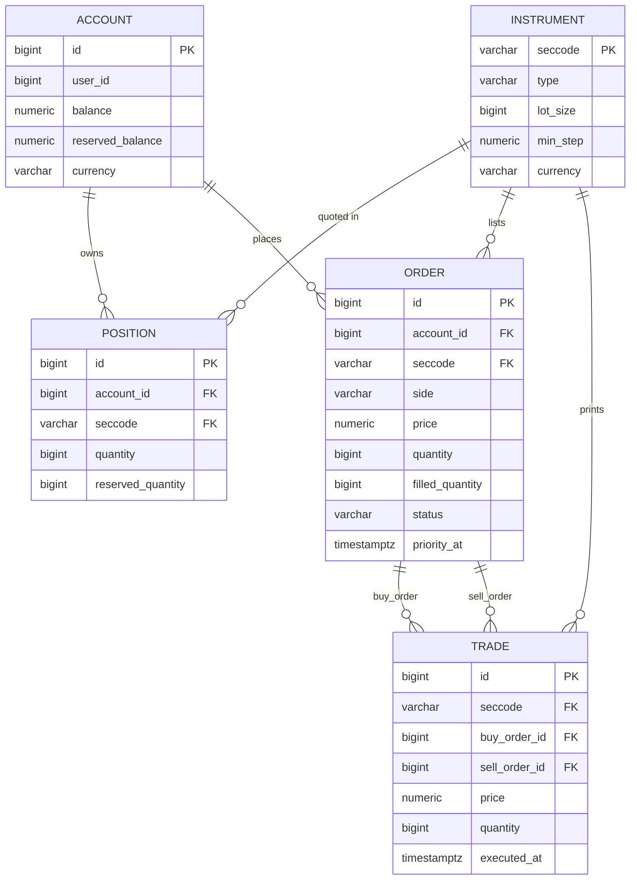

# TradingAppSPVB

Учебный backend лимитного стакана: регистрация инструментов, счета и позиции, выставление заявок, синхронное сопоставление и рыночные данные. Проект выполнен как тестовое задание на стажировку в департамент разработки ПО Санкт-Петербургской валютной биржи.

Это один процесс Spring Boot. Matching engine исполняет заявку в той же транзакции, в которой резервируются деньги или бумаги. Отдельных сервисов аутентификации, клиринга и рыночных данных нет.

## Технологический стек

Версии, зафиксированные в проекте:

| Компонент | Версия |
|---|---|
| Java | 21 (`java.version` в `pom.xml`; образ сборки `eclipse-temurin:21`) |
| Spring Boot | 3.5.16 |
| Spring Web, Spring Data JPA, Jakarta Validation | из BOM Spring Boot |
| PostgreSQL | 16, образ `postgres:16-alpine` |
| Flyway | `flyway-core` и `flyway-database-postgresql`, версия из BOM |
| Springdoc OpenAPI | 2.8.17 |
| Lombok | из BOM, обработка аннотаций включена (`maven-compiler-plugin`, `proc=full`) |
| JUnit 5, Mockito, AssertJ | `spring-boot-starter-test` |
| Testcontainers | 1.21.4 вместе с `spring-boot-testcontainers` |

Деньги хранятся как `BigDecimal` и в PostgreSQL как `NUMERIC(19,8)`. Количество лотов и бумаг — `long` / `BIGINT`.

В последнем прогоне тестов контейнер сообщил PostgreSQL 16.16 и Hibernate ORM 6.6.53.Final. Patch-версия образа `postgres:16-alpine` в Compose не закреплена.

## Быстрый запуск

Нужны Docker и Docker Compose. Команды ниже взяты из `Dockerfile` и `docker-compose.yml`; сам Compose в рамках подготовки этой документации не запускался.

Из корня проекта создайте `.env` из `.env.example` и задайте `DB_PASSWORD`. Compose не стартует, пока переменная пуста. Файл `.env` в репозиторий не входит. Внутри сети Compose приложение само получает `DB_URL=jdbc:postgresql://postgres:5432/trading`; значение из `.env` нужно локальному запуску.

Windows:

```powershell
copy .env.example .env
docker compose up -d --build
```

Linux и macOS:

```bash
cp .env.example .env
docker compose up -d --build
```

При `SERVER_PORT=8080` интерфейс API доступен по адресам:

- Swagger UI: `http://localhost:8080/swagger-ui.html`
- OpenAPI: `http://localhost:8080/v3/api-docs`

Порты опубликованы только на `127.0.0.1`. PostgreSQL на хосте слушает `5433`, чтобы не занимать локальный `5432`. Приложение внутри Compose ходит в базу по имени сервиса `postgres` и порту `5432`.

Остановка без удаления данных:

```bash
docker compose down
```

Именованный volume `trading-pg` при этом сохраняется.

Образ собирается многоэтапно: зависимости и пакет загружаются Maven Wrapper, тесты при сборке образа пропускаются (`-DskipTests`), в runtime копируется JAR и процесс запускается от пользователя `spring`.

## Локальный запуск

На машине разработки нужны JDK, способный компилировать target 21, Maven Wrapper из репозитория и Docker только для PostgreSQL. Рабочий каталог — корень проекта: `application.properties` читает необязательный файл `.env` из текущего каталога.

Поднимите одну базу:

```bash
docker compose up -d postgres
```

Дождитесь состояния healthy. В `.env` для этого режима должны быть заданы `SERVER_PORT`, `DB_URL`, `DB_USERNAME` и `DB_PASSWORD`. Шаблон указывает приложение на `localhost:5433` и базу `trading`.

Windows:

```powershell
.\mvnw.cmd spring-boot:run
```

Linux и macOS:

```bash
./mvnw spring-boot:run
```

Hibernate работает в режиме `validate` и схему не создаёт. Её создаёт Flyway миграциями `V1__init_schema` и `V2__add_order_priority`. В локальном `application.properties` включён `show-sql`; у сервиса `app` в Compose он выключен через `SPRING_JPA_SHOW_SQL`.

## Архитектура

Приложение слоистое и намеренно остаётся одним модулем.

| Слой | Пакет | Ответственность |
|---|---|---|
| HTTP | `controller` | Маршруты, коды ответа, запуск валидации тела |
| Применение | `service` | Правила заявок, резерв, matching, стакан |
| Хранение | `repository` | JPA-запросы и pessimistic lock |
| Модель | `entity`, `enums` | Таблицы и допустимые значения |
| Контракт | `dto.request`, `dto.response` | Записи запросов и ответов, без сущности наружу |
| Ошибки | `exception` | Бизнес-исключения и `ErrorResponse` |
| Инфраструктура | `config`, `time` | OpenAPI и обрезка `Instant` до микросекунд |

Контроллер не считает сделку и не блокирует строки. `MatchingService` и `ReservationService` помечены `Propagation.MANDATORY`: они присоединяются к транзакции `OrderService`, а не открывают свою.

Монолит здесь уместен. Резерв, сделка и смена статуса должны зафиксироваться вместе. Вынос matching в отдельный процесс потребовал бы очередь и распределённую транзакцию, которых у задания нет. Границы слоёв при этом сохранены: HTTP, правила и SQL не смешаны в одном классе.

`seccode` перед поиском обрезается и переводится в верхний регистр.

## Модель данных

Пять таблиц. Деньги — `NUMERIC(19,8)`, не больше `99999999999.99999999`. Время — `timestamptz`.

`Instrument` — торговый инструмент. Первичный ключ `seccode` (до 32 символов). Поля: `type` (`STOCK`, `BOND`, `CURRENCY_PAIR`), `lotSize`, `minStep`, `currency` (`RUB`, `USD`, `EUR`, `CNY`).

`Account` — денежный счёт. Поля: `userId`, `balance`, `reservedBalance`, `currency`. Пользователь отдельной таблицей не моделируется: несколько счетов могут иметь один `userId`. Ограничения не позволяют отрицательный баланс и резерв больше баланса.

`Position` — бумаги одного инструмента на счёте. Уникальна пара (`account`, `seccode`). Поля: `quantity`, `reservedQuantity`. Это учётное количество в приложении, а не запись депозитария. Повторно открыть ту же позицию нельзя.

`Order` — лимитная заявка. `quantity` и `filledQuantity` заданы в лотах, не в бумагах. `side` — `BUY` или `SELL`. Статусы: `NEW`, `PARTIALLY_FILLED`, `FILLED`, `CANCELLED`. `priorityAt` задаёт временной приоритет и в REST-ответ не входит. `createdAt` после вставки не обновляется.

`Trade` — заключённая сделка: инструмент, заявка покупателя, заявка продавца, цена, количество лотов, `executedAt`. Заявка не может быть одновременно обеими сторонами сделки.



Активные заявки индексируются по инструменту, цене, `priority_at` и `id`. Для покупок цена в индексе убывает, для продаж растёт.

## Matching Engine

Сопоставление синхронное и происходит сразу после резервирования новой или изменённой заявки. В стакане участвуют только `NEW` и `PARTIALLY_FILLED`.

Цена встречной заявки должна пересекать входящую:

- покупка забирает продажи с ценой не выше своей лимитной цены, сначала самые дешёвые;
- продажа забирает покупки с ценой не ниже своей лимитной цены, сначала самые дорогие.

При равной цене раньше стоит заявка с меньшим `priorityAt`, затем с меньшим `id`. Это Price-Time Priority: цена важнее времени, а при одной цене очередь FIFO.

Цена сделки — цена стоящей встречной заявки, не цена агрессора. Покупатель, заявивший 250, исполняется по уже стоящим 240 и платит 240. Продавец, который приходит к стоящей покупке 250, получает 250.

Объём одной сделки — минимум остатков двух заявок в лотах. Если объёмы равны, обе заявки становятся `FILLED`. Если агрессор больше, он остаётся `PARTIALLY_FILLED` и идёт к следующей встречной заявке. Если больше стоящая заявка, агрессор становится `FILLED`, а остаток стоящей сохраняет её `priorityAt`.

Полностью исполненная заявка повторно не выбирается: её статус уже не активный, а остаток лотов нулевой.

Редактирование (`PATCH`) снимает старый резерв и ставит новый. `priorityAt` обновляется, если изменилась цена или количество лотов увеличилось. Уменьшение количества оставляет заявку на прежнем месте в очереди. Повторная отправка тех же цены и количества не трогает ни резерв, ни приоритет. Пустое тело отклоняется. Новое количество должно быть больше уже исполненного.

Жизненный цикл:

1. `NEW` — заявка принята, резерв создан, встречных заявок не нашлось либо исполненного объёма ещё нет.
2. `PARTIALLY_FILLED` — часть лотов исполнена, остаток и его резерв остаются в стакане.
3. `FILLED` — остатка нет. Отмена и изменение возвращают 409.
4. `CANCELLED` — активная заявка снята пользователем либо остановлена правилом Self-Trade Prevention. Уже исполненные лоты и сделки сохраняются. Снять можно только `NEW` и `PARTIALLY_FILLED`.

Self-Trade Prevention — Cancel Aggressor. Сравнение идёт по `userId`, поэтому запрещена и сделка одного счёта с самим собой, и сделка между разными счетами одного пользователя. Когда обход очереди доходит до совместимой встречной заявки того же пользователя, движок:

- не создаёт сделку с этой заявкой;
- не пропускает её ради худшей чужой заявки;
- снимает резерв неисполненного остатка агрессора;
- переводит агрессора в `CANCELLED`;
- оставляет уже созданные в этом проходе сделки;
- не меняет стоящую встречную заявку и прекращает обход.

Ответ размещения при этом остаётся `201`: отмена агрессора — результат сопоставления, а не отказ принять заявку. Заявки одного пользователя с непересекающимися ценами обе остаются в стакане, и чужой участник может исполнить любую из них.

## Резервирование активов и расчёты

У счёта три денежные величины. `balance` — все деньги. `reservedBalance` — сумма, уже отложенная под активные покупки. `availableBalance = balance - reservedBalance`. Под продажу деньги не резервируются.

У позиции то же разделение: `quantity`, `reservedQuantity` и `availableQuantity = quantity - reservedQuantity`. Резерв бумаг создаёт только активная продажа.

Заявка измеряется в лотах. Бумаги и деньги считаются так:

```text
securities = lots × lotSize
cash       = price × securities
```

Покупка резервирует `price × remainingLots × lotSize` по своей лимитной цене. Продажа резервирует `remainingLots × lotSize` бумаг. Цена продажи должна делиться на `minStep` без остатка. Валюта счёта и инструмента обязана совпадать. Продажа без открытой позиции или сверх доступного остатка отклоняется до записи заявки.

При сделке покупатель платит цену сделки, а не обязательно свой лимит. С его `balance` списывается сумма по цене стоящей заявки, а из `reservedBalance` снимается резерв по его лимитной цене на исполненные лоты. Разница остаётся ему: это улучшение цены. Продавец получает сумму сделки на `balance`. Бумаги списываются у продавца вместе с резервом этих бумаг и зачисляются покупателю. Если позиции покупателя ещё не было, она создаётся в той же транзакции.

Отмена снимает резерв только неисполненного остатка. Частично исполненная покупка после отмены сохраняет уже списанные деньги и полученные бумаги. Полное исполнение само обнуляет резерв, потому что остатка больше нет.

Переполнение, которое ещё можно выразить правилом `NUMERIC(19,8)`, останавливается до изменения баланса: слишком большая сумма или больше восьми знаков после запятой даёт бизнес-ошибку. Переполнение количества бумаг при зачислении покупателю обрабатывается так же. Отрицательные остатки в код этой проверки не превращаются: их держит ограничение базы.

## Транзакционность и конкурентный доступ

Размещение, изменение и отмена заявки — одна транзакция Spring. Исключение до commit откатывает и новую заявку, и уже начатые в этом вызове сделки.

Порядок блокировок при размещении и изменении:

1. строка инструмента `SELECT … FOR UPDATE`;
2. денежные счета входящей заявки и всех счетов с активными заявками этого инструмента, тоже `FOR UPDATE`, по возрастанию `id`;
3. строки позиций, когда резервируются или переводятся бумаги: при сделке сначала позиция продавца, затем покупателя.

Отмена блокирует инструмент и счёт самой заявки, затем позицию, если освобождаются бумаги. Общая блокировка инструмента сериализует сопоставление по одному `seccode`. Счета в порядке `id` не захватываются в произвольной последовательности. Позиции одного инструмента не блокируются параллельно двумя такими операциями, потому что вторая ждёт строку инструмента.

Котировка читается в `REPEATABLE READ`. Стакан внутри этого чтения строится из активных заявок; последняя сделка выбирается отдельно по `executedAt DESC, id DESC`. Это снимок одного запроса, а не поток рыночных данных.

Повторное исполнение исключается статусом и остатком: после перехода в `FILLED` заявка больше не попадает в выборку встречных. Конкурентные тесты проверяют два следствия: несколько покупок одного счёта не резервируют больше доступных денег, и несколько покупателей не исполняют одну продажу дважды.

## REST API

Базовый префикс — `/api`. Успешное создание инструмента, счёта, позиции и заявки возвращает `201`. Отмена заявки возвращает `200` и тело отменённой заявки.

| Метод | Путь | Назначение |
|---|---|---|
| `POST` | `/api/instruments` | Зарегистрировать инструмент |
| `GET` | `/api/instruments` | Список инструментов |
| `GET` | `/api/instruments/{seccode}` | Инструмент по коду |
| `POST` | `/api/accounts` | Открыть счёт |
| `GET` | `/api/accounts?userId=` | Все счета или счета одного `userId` |
| `GET` | `/api/accounts/{id}` | Счёт по идентификатору |
| `POST` | `/api/accounts/{id}/positions` | Открыть позицию |
| `GET` | `/api/accounts/{id}/positions` | Позиции счёта |
| `GET` | `/api/accounts/{id}/positions/{seccode}` | Одна позиция |
| `POST` | `/api/orders` | Выставить заявку и сразу сопоставить её |
| `GET` | `/api/orders?accountId=` или `?seccode=` | Все заявки либо один фильтр |
| `GET` | `/api/orders/{id}` | Заявка |
| `PATCH` | `/api/orders/{id}` | Изменить цену и/или количество |
| `DELETE` | `/api/orders/{id}` | Отменить активный остаток |
| `GET` | `/api/trades?seccode=` | Реестр сделок, при фильтре — только инструмент |
| `GET` | `/api/trades/{id}` | Сделка |
| `GET` | `/api/orderbook/{seccode}` | Агрегированный стакан |
| `GET` | `/api/quotes/{seccode}` | Лучшие цены, спред и последняя сделка |

Оба фильтра заявок одновременно вернуть нельзя. Неизвестный `userId` в списке счетов даёт пустой массив. Неизвестный счёт или инструмент в фильтре заявок, сделок, стакана и котировок даёт `404`. Существующий счёт или инструмент без заявок даёт `200` и `[]`.

`GlobalExceptionHandler` возвращает `ErrorResponse`:

| Поле | Смысл |
|---|---|
| `timestamp` | момент ошибки |
| `status` | числовой HTTP-код |
| `error` | стандартная причина статуса |
| `message` | текст исключения |
| `path` | путь запроса |
| `details` | поля валидации; для остальных ошибок пустой объект |

| Код | Когда |
|---|---|
| `400` | JSON не читается или не проходит Jakarta Validation |
| `404` | нет инструмента, счёта, позиции, заявки или сделки |
| `409` | повтор инструмента или позиции; заявка уже `FILLED` или `CANCELLED` |
| `422` | бизнес-правило: баланс, бумаги, шаг цены, валюта, пустой `PATCH`, денежный предел |

Несовпадение типа path- или query-параметра обрабатывает Spring MVC до этого формата. Успешные тела описаны записями в пакете `dto.response`; интерактивная схема — в Swagger UI.

В стакане уровень содержит цену, суммарный остаток лотов и число заявок. Покупки отсортированы по убыванию цены, продажи по возрастанию. `FILLED` и `CANCELLED` в стакан не входят. Спред равен `bestAsk - bestBid` и отсутствует, если одной из сторон нет. Сделки в реестре идут по `executedAt DESC, id DESC`.

## Пример использования

Ниже один инструмент `SBER`: лот 10, шаг `0.01`, валюта `RUB`. Сначала выставляется продажа, поэтому ценой сделки будет цена стоящей заявки.

Продавец получает 1000 бумаг и продаёт 5 лотов по 240. Покупатель со 100000 выставляет 10 лотов по 250. Исполняются 5 лотов:

```text
5 × 10 × 240 = 12000
```

Остаток покупки — 5 лотов. Резерв остатка считается по лимиту покупателя:

```text
5 × 10 × 250 = 12500
```

На Windows вызывайте `curl.exe`: в PowerShell имя `curl` может быть алиасом `Invoke-WebRequest`. Подставьте идентификаторы из предыдущих ответов.

```bash
curl -s -X POST http://localhost:8080/api/instruments \
  -H "Content-Type: application/json" \
  -d '{"seccode":"SBER","type":"STOCK","lotSize":10,"minStep":0.01,"currency":"RUB"}'

curl -s -X POST http://localhost:8080/api/accounts \
  -H "Content-Type: application/json" \
  -d '{"userId":1,"balance":100000,"currency":"RUB"}'

curl -s -X POST http://localhost:8080/api/accounts \
  -H "Content-Type: application/json" \
  -d '{"userId":2,"balance":0,"currency":"RUB"}'

curl -s -X POST http://localhost:8080/api/accounts/{sellerId}/positions \
  -H "Content-Type: application/json" \
  -d '{"seccode":"SBER","quantity":1000}'

curl -s -X POST http://localhost:8080/api/orders \
  -H "Content-Type: application/json" \
  -d '{"accountId":{sellerId},"seccode":"SBER","side":"SELL","price":240,"quantity":5}'

curl -s -X POST http://localhost:8080/api/orders \
  -H "Content-Type: application/json" \
  -d '{"accountId":{buyerId},"seccode":"SBER","side":"BUY","price":250,"quantity":10}'
```

Ожидаемое состояние после покупки:

| Показатель | Значение |
|---|---|
| Сделка | одна, 5 лотов по 240 |
| Продажа | `FILLED` |
| Покупка | `PARTIALLY_FILLED`, исполнено 5, осталось 5 |
| Баланс покупателя | 88000 |
| Резерв покупателя | 12500 |
| Доступно покупателю | 75500 |
| Баланс продавца | 12000 |
| Позиция покупателя | 50 бумаг |
| Позиция продавца | 950 бумаг, резерв 0 |

Сумма денег остаётся 100000, сумма бумаг — 1000. Покупатель платит 12000, а не 12500: 500 — улучшение относительно его лимита 250. Эти 500 не списываются с баланса; резерв исполненной части по цене 250 снимается целиком.

Стакан после сделки содержит одну покупку: цена 250, остаток 5 лотов, одна заявка. Продаж нет. Котировка: `bestBid = 250`, `bestAsk` и `spread` пустые, `lastTradePrice = 240`.

```bash
curl -s "http://localhost:8080/api/trades?seccode=SBER"
curl -s http://localhost:8080/api/orderbook/SBER
curl -s http://localhost:8080/api/quotes/SBER

curl -s -X DELETE http://localhost:8080/api/orders/{buyOrderId}
```

Отмена переводит покупку в `CANCELLED`, оставляет `filledQuantity = 5` и ту же сделку. Баланс покупателя остаётся 88000, резерв становится 0, доступно 88000. Позиции не откатываются. Стакан больше не показывает эту покупку, последняя цена в котировке сохраняется.

## Тестирование

Модульные тесты в пакете `unit` проверяют резерв, денежный предел `NUMERIC(19,8)` и обрезку времени. Mockito используется только для репозитория позиций. JUnit 5 и AssertJ сравнивают `BigDecimal` по числовому значению.

Интеграционные тесты в пакете `integration` поднимают приложение с MockMvc и отдельной PostgreSQL 16 через Testcontainers. База называется `trading_it`. Контейнер — Spring-бин с `@ServiceConnection`: его жизненный цикл совпадает с кэшем `ApplicationContext`, поэтому следующий тестовый класс не обращается к уже остановленному контейнеру. Flyway применяет те же миграции. Перед каждым тестом очищаются только `trades`, `orders`, `positions`, `accounts` и `instruments`, и только если текущая база и JDBC URL относятся к `trading_it`. Класс тестов не обёрнут в `@Transactional`, чтобы были видны реальные границы транзакций приложения.

Основная база Compose этими тестами не используется.

Windows:

```powershell
.\mvnw.cmd test
.\mvnw.cmd clean verify
```

Linux и macOS:

```bash
./mvnw test
./mvnw clean verify
```

Последний подтверждённый результат — два последовательных `mvnw.cmd clean verify`: 36 тестов, 0 ошибок, 0 пропущенных. Из них 11 модульных и 25 интеграционных. Второй прогон занял 22,2 с.

## Архитектурные решения

PostgreSQL выбран потому, что заявке нужны ограничения `CHECK`, `NUMERIC` и строковые блокировки в одной базе. Flyway хранит схему в репозитории и не позволяет Hibernate менять её в `validate`.

`BigDecimal` не накапливает двоичную ошибку цены и шага. Pessimistic lock на инструменте и счетах делает конкурентное резервирование видимым в SQL, без отдельного распределённого замка.

DTO-записи отделяют JSON от JPA-сущностей: наружу не уходит `priorityAt`, ленивые связи и служебные поля. Синхронный matching проще проверить инвариантами денег и бумаг: клиент сразу получает статус после сделки, а не квитанцию о постановке в очередь.

## Ограничения

Проект не является биржевой системой для промышленной эксплуатации.

Нет аутентификации, ролей и аудита действий. Нет пагинации. Нет потоковых котировок, истории стакана и торговых сессий. Заявки только лимитные: нет рыночных, stop, IOC и FOK. Нет комиссий, клиринга, расчётов по дате поставки и корпоративных действий.

Позицию нельзя пополнить отдельным запросом после создания, а на счёт нельзя внести деньги иначе как начальным балансом и сделками. Валюты не конвертируются. Один экземпляр приложения рассчитан на одну базу; горизонтальное масштабирование matching не заложено.

Ожидаемый выход за `NUMERIC(19,8)` возвращается как бизнес-ошибка. Непредвиденное нарушение ограничения базы остаётся ошибкой СУБД. Журнал SQL в локальных настройках включён. Сборка Docker-образа не прогоняет тесты.
